<h1 align="center">MIGGY TADURAN</h1>

  <strong>Full Stack Developer</strong> &nbsp;·&nbsp; IT Student
   
  FEU Institute of Technology

  <strong>Building thoughtful full-stack applications from interface to infrastructure.</strong>

  <a href="https://deliverexapp.com/"><strong>Live Project ↗</strong></a>
  &nbsp;·&nbsp;
  <a href="https://www.linkedin.com/in/jm-taduran-579238319/"><strong>LinkedIn ↗</strong></a>
  &nbsp;·&nbsp;
  <a href="https://github.com/taduranmiggy"><strong>GitHub ↗</strong></a>

 

  

 

  FULL STACK DEVELOPMENT &nbsp;·&nbsp; WEB APPLICATIONS &nbsp;·&nbsp; APIs &amp; DATABASES

 

## 01 / About

I'm Miggy Taduran, an Information Technology student at FEU Institute of Technology focused on full-stack development. I build practical web applications across the frontend and backend, with an emphasis on clear interfaces, dependable APIs, and maintainable application architecture.

## 02 / Featured Project

### Deliverex

LOGISTICS &amp; FLEET MANAGEMENT SYSTEM

 

  

  

 

Deliverex is a role-based logistics and fleet platform that coordinates job orders, explainable driver-and-vehicle matching, real-time GPS tracking, offline field workflows, and OCR-assisted delivery-document validation.

**Core stack** &nbsp; `React` · `Laravel` · `FastAPI` · `MySQL` · `Pusher / Reverb` · `Leaflet`

**[View Live System ↗](https://deliverexapp.com/)** &nbsp;·&nbsp; **[Source Code ↗](https://github.com/taduranmiggy/deliverex)**

## 03 / Tech Stack

  

  <strong>Frontend</strong>
   
  
   
  React · TypeScript · Vite · Tailwind CSS · React Router · Leaflet

  <strong>Backend</strong>
   
  
   
  PHP · Laravel · Node.js · Express · Python · FastAPI

  <strong>Data</strong>
   
  
   
  MySQL · MongoDB · SQLite

  <strong>Tooling</strong>
   
  
   
  Git · Docker · GitHub Actions

## 04 / Selected Work

### Ka-Agapay

A healthcare management system for Rural Health Units, covering patient records, telemedicine, medicine inventory, and privacy-aware access workflows.

`React` · `Laravel` · `Tailwind CSS` · `MySQL`

[Repository ↗](https://github.com/taduranmiggy/kaagapay)

### Himlayan

A smart cemetery navigation and digital plot management system with GIS mapping, burial records, and QR-based plot access.

`React` · `Laravel` · `Leaflet` · `MySQL`

[Repository ↗](https://github.com/taduranmiggy/himlayan)

### CocoirStore

A buyer-and-seller e-commerce platform for coconut coir products with catalog, cart, order, inventory, and reporting workflows.

`React` · `Express` · `MongoDB`

[Repository ↗](https://github.com/taduranmiggy/cocoloco)

## 05 / Repository Guide

The repositories in the first group below are the best snapshot of my current full-stack capabilities.

### Featured full-stack systems

- **[deliverex](https://github.com/taduranmiggy/deliverex)** — Production-focused logistics and fleet platform showing end-to-end system delivery across frontend, backend, and operations workflows.
- **[kaagapay](https://github.com/taduranmiggy/kaagapay)** — Healthcare management system work focused on practical records, access workflows, and service operations for local health offices.
- **[himlayan](https://github.com/taduranmiggy/himlayan)** — GIS-oriented cemetery management project combining mapping, records handling, and location-based workflows.
- **[cocoloco](https://github.com/taduranmiggy/cocoloco)** — E-commerce application project demonstrating catalog, ordering, and inventory-related business flows.

### Additional applications

- **[diaryapp](https://github.com/taduranmiggy/diaryapp)** — Kotlin-based diary application project that demonstrates mobile app implementation fundamentals.
- **[jorney](https://github.com/taduranmiggy/jorney)** — Small web application prototype used to practice frontend structure and interaction patterns.
- **[LOVE](https://github.com/taduranmiggy/LOVE)** — Browser game project showing interactive UI and basic game-flow implementation.
- **[loveyou](https://github.com/taduranmiggy/loveyou)** — Lightweight TypeScript web project used for focused UI and deployment practice.

### Collaboration / study

- **[devasc-study-team](https://github.com/taduranmiggy/devasc-study-team)** — Collaboration space for shared study exercises and team-based practice.

### In progress / needs polishing

- **[devmigoportfolio](https://github.com/taduranmiggy/devmigoportfolio)** — Work-in-progress portfolio concept that is still being refined.
- **[FLEETOPS](https://github.com/taduranmiggy/FLEETOPS)** — Early-stage repository reserved for a future fleet-operations focused buildout.

## 06 / GitHub Activity

Follow my latest public work and contribution history directly on GitHub.

[View contribution activity ↗](https://github.com/taduranmiggy?tab=overview) &nbsp;·&nbsp; [Browse repositories ↗](https://github.com/taduranmiggy?tab=repositories)

## 07 / Currently

| | |
| :--- | :--- |
| **Studying** | Information Technology at FEU Institute of Technology |
| **Focus** | Full Stack Development |
| **Building** | Web applications, APIs, and practical systems |

## 08 / Let's Connect

I'm always interested in connecting with fellow developers and discussing interesting software projects.

**[LinkedIn ↗](https://www.linkedin.com/in/jm-taduran-579238319/)** &nbsp;·&nbsp; **[GitHub ↗](https://github.com/taduranmiggy)** &nbsp;·&nbsp; **[Deliverex ↗](https://deliverexapp.com/)**

  @taduranmiggy · Full Stack Development · FEU Institute of Technology

